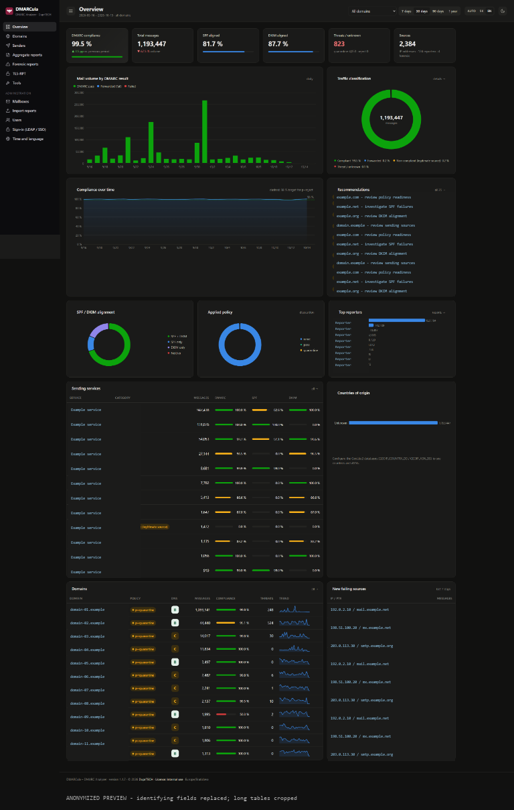
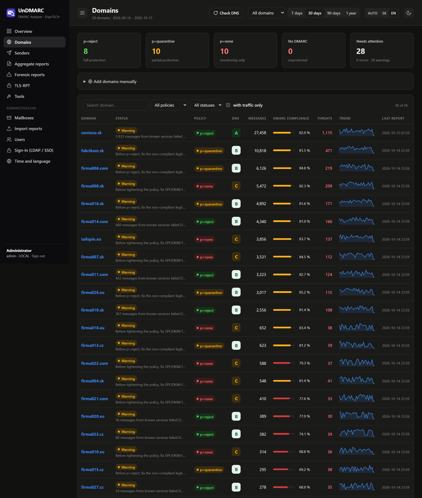
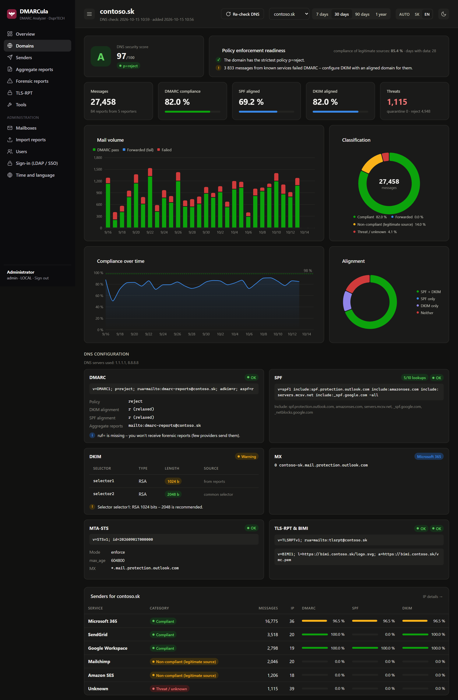
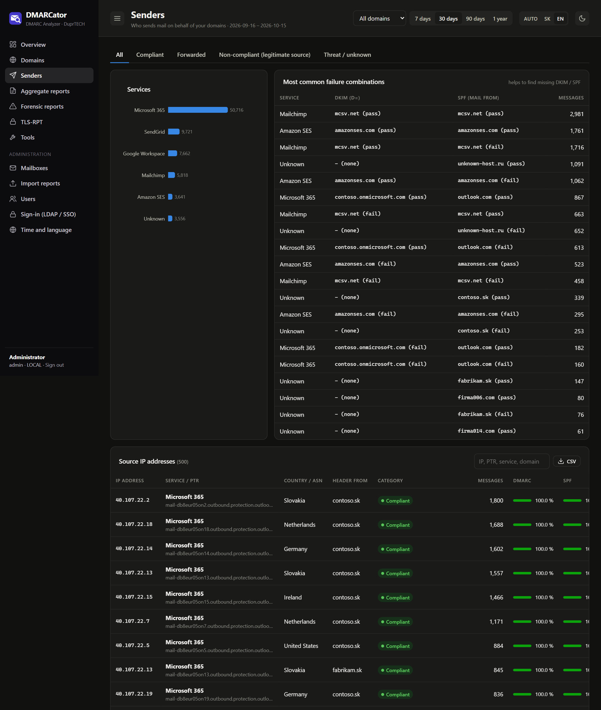
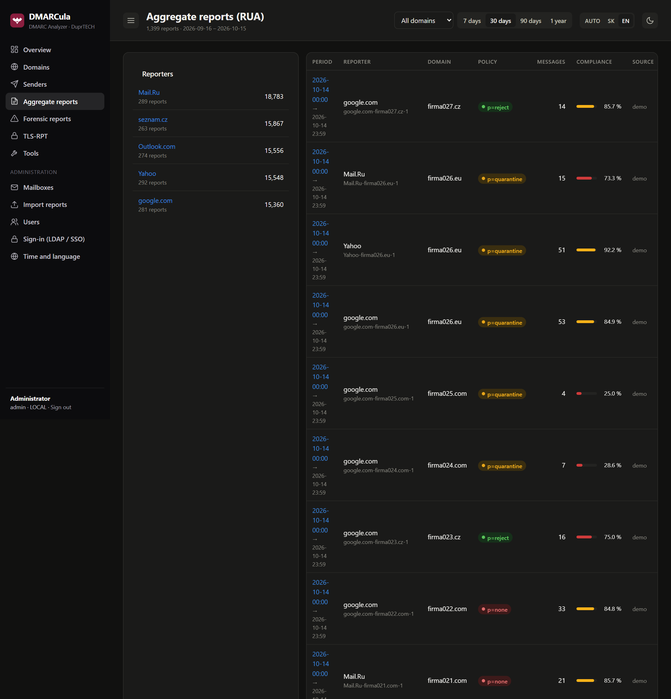
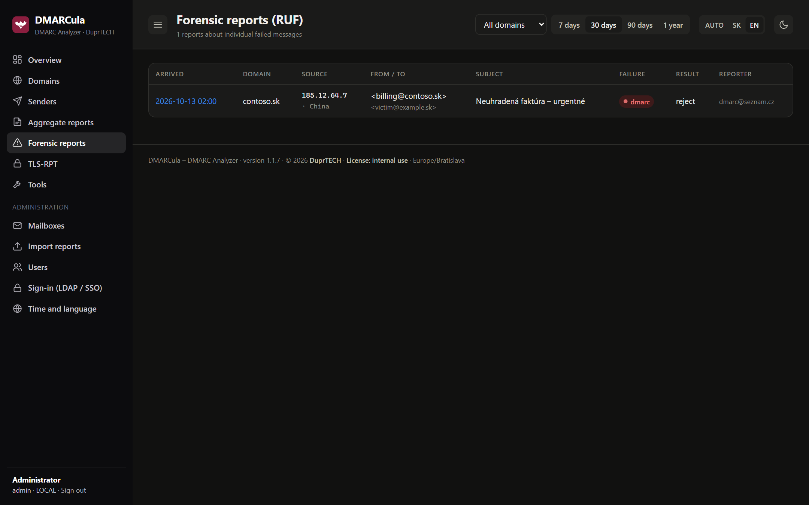
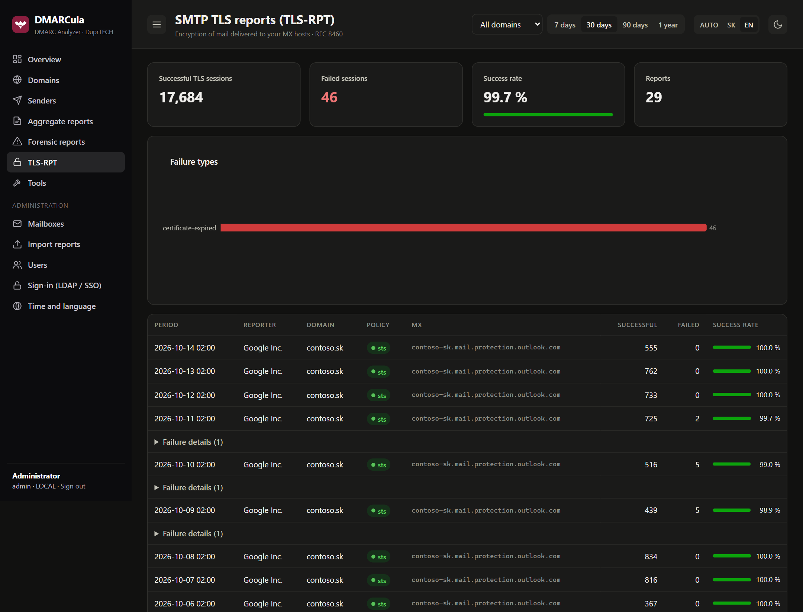
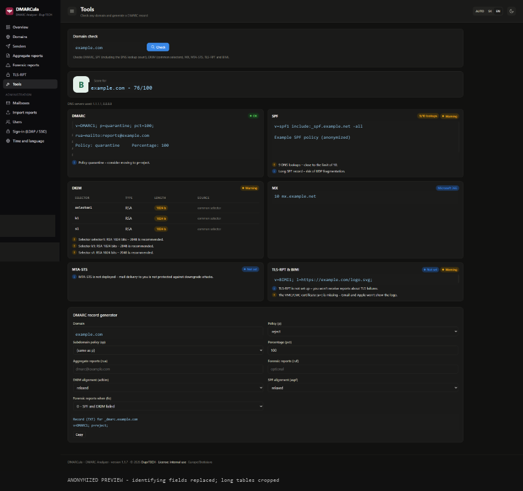
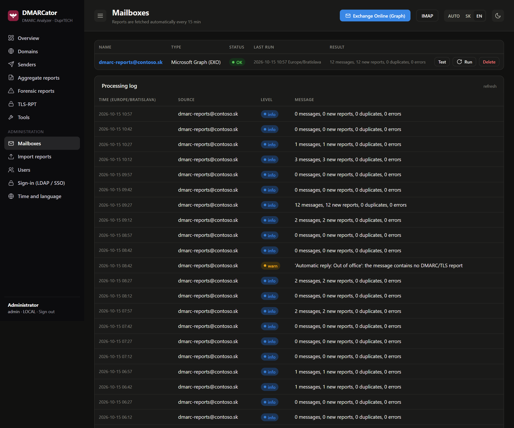

# DMARCator – free self-hosted DMARC analyzer and report monitoring

**DMARCator is a free, self-hosted DMARC report analyzer** with a web dashboard. It collects
DMARC aggregate (RUA) and forensic (RUF) reports and SMTP TLS reports (TLS-RPT) from an
**Exchange Online (Microsoft 365)** mailbox, an IMAP mailbox or manual uploads. It parses them,
works out which service sent each message (Microsoft 365, Google Workspace, SendGrid, Mailchimp, …)
and checks SPF, DKIM, DMARC, MTA-STS, TLS-RPT and BIMI DNS records of every domain. The dashboard
is built for managing **many domains** at once and for moving safely from `p=none` to `p=reject`.

A free, self-hosted alternative to DMARC monitoring services such as dmarcian, Valimail,
EasyDMARC and PowerDMARC, and a web UI in the spirit of parsedmarc: your reports and mail metadata
stay on your own server. No subscription, no per-domain or per-message pricing.

> Formerly **DMARCula**. Existing installations are renamed automatically by the installer; see
> [upgrading from DMARCula](docs/installation.md#upgrading-from-dmarcula-before-120).

**Author:** [DuprTECH](https://github.com/DuprTECH) · **License:** [PolyForm Internal Use 1.0.0](LICENSE) (free for internal use in any company) · **Version:** 1.2.0 ([changelog](CHANGELOG.md)) · The user interface is available in **Slovak and English** (switch in the top bar). The documentation is in English.

📖 **Full documentation: [docs/](docs/README.md)**: [Installation](docs/installation.md) · [Operations](docs/operations.md) ·
[Configuration](docs/configuration.md) · [Authentication](docs/authentication.md) ·
[Microsoft 365 setup](docs/microsoft-365.md) · [User guide](docs/user-guide.md) ·
[Architecture](docs/architecture.md)

## Features

| Area | What it does |
|---|---|
| **Login** | configured in the web UI with built-in connection tests: local accounts, **LDAP / Active Directory** (LDAPS/StartTLS, service account or direct UPN bind, group filter, nested groups), **SSO via OpenID Connect** (Entra ID, Keycloak, Okta, ADFS, …). `admin` / `viewer` roles can be mapped from groups. |
| **Ingest** | **Microsoft Graph** (Exchange Online, app-only, client secret or certificate, scoped with RBAC for Applications), **IMAP** (password or OAuth2 XOAUTH2 for Exchange Online), manual upload (.xml, .gz, .zip, .json, .eml). Processed messages are marked read and/or moved, and duplicates are skipped. |
| **Reports** | aggregate (RUA), including the DMARC 2.0 namespace; forensic (RUF / ARF); SMTP TLS reporting (TLS-RPT, RFC 8460) |
| **Classification** | compliant / forwarded / non-compliant legitimate source / threat, dmarcian-style. Recognizes 60+ sending services and M365 tenants without custom DKIM. |
| **Dashboard** | KPIs compared with the previous period, volume and compliance trends, SPF/DKIM alignment, applied policy, reporters, country breakdown, services, domains with sparklines, new failing sources, recommendations |
| **Domains** | A–F DNS score: DMARC (incl. external `rua` authorization), SPF (recursive lookup count, void lookups, `+all`/`ptr`), DKIM (selectors from reports + common ones, key length), MX, MTA-STS (fetches and validates the policy), TLS-RPT, BIMI. Plus **readiness for `p=quarantine` / `p=reject`**. Search and filters for 100+ domains. |
| **Domains, manual** | add domains by hand (bulk, one per line). They are checked immediately and then daily, even before the first report arrives |
| **Tools** | DNS check of any domain, DMARC record generator, CSV export, dark mode, responsive layout, **Slovak / English UI** |
| **Databases** | MariaDB / MySQL, PostgreSQL or SQLite. Schema and indexes are created and upgraded automatically. |
| **Sender investigation** | Search source IPs, PTR names, services and domains; inspect common DKIM/SPF failure combinations; filter traffic categories and export the sender table to CSV. |
| **Report details** | Inspect aggregate records, authentication results and policy override reasons; download retained original XML. Forensic views show message headers and failure fields; TLS-RPT lists TLS delivery successes and failures. |
| **IP enrichment** | Reverse DNS, plus optional country and ASN lookups using local MaxMind GeoLite2 databases. Countries remain unknown without a configured, readable country database. No third-party IP lookup API is required ([GeoLite2 setup](docs/configuration.md#setting-up-geolite2-countries-map-and-asns)). |
| **Reliable processing** | Scheduled polling, per-report database transactions, duplicate detection, per-message error isolation and source status/logs. Reports without a date range have a fallback period; common non-standard forensic formats are supported. |
| **Mailbox retention** | Opt-in checkbox and retention days for global Microsoft Graph. Permanently deletes old, explicitly marked successful reports from a dedicated processed folder, at most 500 per run. Disabled by default; not quota monitoring and **does not guarantee 10% free space**. |
| **Time and language** | Web-admin settings for a shared IANA time zone (including automatic daylight-saving changes) and default language. Personal SK/EN overrides and AUTO reset. Stored timestamps remain UTC. |
| **Operations** | Built-in polling and DNS scheduler, health/version endpoint, CLI mailbox status, manual polling/DNS refresh, database report/log pruning, password/admin recovery, and documented backup/cron workflows. |

### What the portal helps you do

1. **Centralize reporting** across many domains and mailboxes, from ingestion to searchable report details.
2. **Find legitimate senders that fail DMARC** and distinguish them from forwarding and unknown sources.
3. **Plan a stricter DMARC policy** using observed legitimate-mail compliance and domain readiness recommendations.
4. **Audit email DNS configuration** and generate a DMARC TXT record to publish with your DNS provider.
5. **Track changes over time**, including new failing IPs, service volumes and domain compliance.
6. **Operate internally** with administrator/viewer roles, local/LDAP/OIDC sign-in, multilingual UI and maintenance tools.

DMARCator analyzes reports and makes recommendations: it is **not an email gateway**, does not
block mail itself, and does not automatically publish DNS changes. Service/threat classification
and policy readiness are diagnostic guidance, not proof that a message is malicious or that a
policy change is risk-free. GeoIP describes the sending IP's estimated location, not the sender's
identity. See the [user guide](docs/user-guide.md) for interpretation and the
[configuration guide](docs/configuration.md) for optional GeoIP and mailbox-retention prerequisites.

## Screenshots

All screenshots come from the built-in synthetic demo dataset (`python -m app.demo`), with
fictitious domains (contoso.sk, fabrikam.sk, firmaNNN.*) and a mailbox and DNS results seeded for
the demo. They contain **no real customer data**. Long pages are cropped.

### Overview

Compliance, volume, alignment, services, recommendations, countries and domain trends in one dashboard.



<details>
<summary><strong>Domains — policy, DNS health and compliance</strong></summary>

Search and filter domains, compare DNS scores, review policies and spot domains needing attention.



</details>

<details>
<summary><strong>Domain detail — DNS audit and policy enforcement readiness</strong></summary>

A–F DNS score, readiness for p=reject, per-domain trends and the DMARC, SPF, DKIM, MX, MTA-STS,
TLS-RPT and BIMI checks, plus the services sending on behalf of the domain.



</details>

<details>
<summary><strong>Senders — services, failure combinations and source IPs</strong></summary>

Investigate SPF/DKIM failure combinations, source IPs, PTR names, countries and traffic categories.



</details>

<details>
<summary><strong>Aggregate reports (RUA)</strong></summary>

Browse reporting organizations, report periods, policies and message compliance.



</details>

<details>
<summary><strong>Forensic reports (RUF)</strong></summary>

Inspect individual failed messages: source, sender and recipient, subject, failure type and reporter.



</details>

<details>
<summary><strong>SMTP TLS reports (TLS-RPT)</strong></summary>

TLS session success rate, failure types and per-MX details from RFC 8460 reports.



</details>

<details>
<summary><strong>Tools — domain check and DMARC record generator</strong></summary>

Check DNS posture of any domain and prepare a DMARC TXT record to publish.



</details>

<details>
<summary><strong>Mailbox administration and processing log</strong></summary>

Configure Exchange Online (Graph) or IMAP sources and inspect polling results and processing status.



</details>

## Installation

On a Linux server (Debian, Ubuntu, RHEL / Rocky / Alma, Fedora, openSUSE):

```bash
curl -fsSL https://raw.githubusercontent.com/DuprTECH/DMARCator-DMARC-Analyzer/main/deploy/install.sh -o install.sh
sudo bash install.sh
```

The installer asks for the host name and admin password. It then creates the system user `dmarcator`
and installs MariaDB, the application (`/opt/dmarcator`), the systemd service, Apache or nginx with HTTPS, and cron jobs for backups.
Running it again updates the application.

Then add the report mailbox in *Administrácia → Poštové schránky*
([Microsoft 365 setup](docs/microsoft-365.md)).

Existing sites, company certificates, Docker, Windows and troubleshooting are covered in
[docs/installation.md](docs/installation.md).

## Requirements

- Python 3.10+ (3.11 / 3.12 recommended)
- MariaDB 10.6+, PostgreSQL 14+ or SQLite
- outbound access to Microsoft Graph / your IMAP server and to DNS
- a single application process (the mailbox scheduler runs in-process)

## Development

A local try-out with SQLite and demo data, plus the test suite, is described in
[docs/architecture.md → Development and tests](docs/architecture.md#development-and-tests).

## Is DMARCator open source?

DMARCator is **free and source-available**: the complete source code is public on GitHub, and any
company may download, run and modify it for its own use at no cost. It is not "open source" in the
OSI sense, because the license does not allow redistributing or reselling it (see below).

## License

DMARCator is **source-available** under the [PolyForm Internal Use License 1.0.0](LICENSE).
Copyright © 2026 DuprTECH.

In plain words (the [LICENSE](LICENSE) text is binding):

- ✅ **Any company or organization may use DMARCator for its own internal operations, for free.**
  This includes commercial companies. You may install it, run it and adapt it for your own needs.
- ❌ You may **not** sell, rent, sublicense or redistribute the software, or offer it to third
  parties as a hosted or paid service.
- ❌ You may **not** publish or distribute it, or a modified version, under another name.
  "DMARCator" and "DuprTECH" are names of the author and may not be used for other products or services.
  The author attribution shown in the application must not be removed.

For any other use (redistribution, resale, hosting for customers, partnership), contact
[DuprTECH](https://github.com/DuprTECH).
